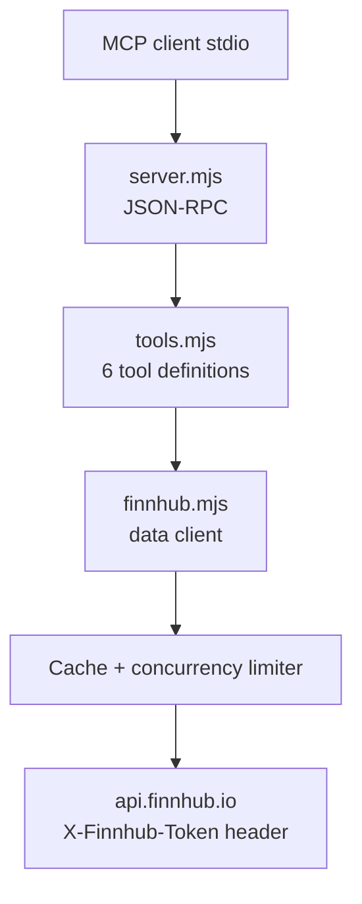

<div align="center">

# 📈 OpenStock Finnhub MCP

**A lightweight stdio MCP server that gives AI agents read-only access to stock quotes, company profiles, market news, and crypto pairs through the Finnhub API.**

Inspired by [OpenStock](https://github.com/Open-Dev-Society/OpenStock), zero npm dependencies, runs on Node 18+.

[](LICENSE)
[](https://nodejs.org/)
[](https://modelcontextprotocol.io/)
[](package.json)
[](#requirements)

[English](README.md) · [简体中文](README_zh-CN.md)

</div>

---

## Why this project?

AI agents are often asked "what's the price of AAPL?" or "any recent news on NVIDIA?". Calling a market-data API directly means handling symbols, auth, rate limits, and malformed responses yourself. This server wraps Finnhub into 6 typed, read-only MCP tools:

- **Zero dependencies** — uses Node's built-in `fetch`; no `npm install` step required at runtime.
- **API key from the environment only** — secrets are never accepted as tool arguments.
- **Stocks and crypto** — equity tickers (`AAPL`, `7203.T`) and crypto pairs (`BINANCE:BTCUSDT`).
- **Resilient** — response caching, request concurrency limiting, HTTP 429/401/403 handled with clear messages; batch quotes keep partial results.

> **Read-only.** This server only retrieves market data — it never places trades or modifies any account.

---

## Requirements

| Requirement | Detail |
|---|---|
| Node.js | 18+ (built-in `fetch`) |
| Finnhub API key | Free at [finnhub.io/register](https://finnhub.io/register) |
| Network | Access to `https://finnhub.io` |

## Get a Finnhub API key

1. Register at [finnhub.io/register](https://finnhub.io/register) and log in.
2. Open the [Dashboard](https://finnhub.io/dashboard).
3. Copy the API Key shown there.

Set it in your environment before starting the server:

```powershell
# Windows (PowerShell)
$env:FINNHUB_API_KEY = "your-key"
```

```bash
# macOS / Linux
export FINNHUB_API_KEY="your-key"
```

> Multiple comma-separated keys are supported via `FINNHUB_API_KEYS` to rotate past rate limits.

---

## MCP client configuration

```json
{
  "mcpServers": {
    "openstock": {
      "command": "node",
      "args": ["C:\\absolute\\path\\to\\openstock\\server.mjs"],
      "env": {
        "FINNHUB_API_KEY": "your-key"
      }
    }
  }
}
```

On macOS / Linux use the corresponding absolute path. If `node` is not on `PATH`, use the full path to your Node executable.

---

## Tools (6)

| Tool | Purpose |
|---|---|
| `search_stocks` | Search tickers / companies / markets by keyword (Finnhub `/search`) |
| `get_stock_quote` | Current price, change, change %, open/high/low/close, previous close, timestamp |
| `get_company_profile` | Company name, exchange, industry, currency, market cap, website, logo |
| `get_market_news` | Latest market news; categories `general` / `forex` / `crypto` / `merger` |
| `get_company_news` | Company news for the last N days, with source, headline, summary, time, URL |
| `get_multiple_quotes` | Batch quotes for up to 10 tickers; partial failures are preserved |

### Symbol examples

| Type | Example |
|---|---|
| US equity | `AAPL`, `TSLA`, `NVDA` |
| Japanese equity | `7203.T` |
| Crypto pair | `BINANCE:BTCUSDT`, `BINANCE:ETHUSDT` |

> Whether quotes are real-time or delayed depends on your Finnhub plan and the market's coverage. The quote result includes a note to that effect.

---

## How it works



- **stdio transport** — pure newline-delimited JSON-RPC over stdin/stdout.
- **Secret handling** — the key is sent in the `X-Finnhub-Token` header, never embedded in a URL or a tool argument.
- **Caching** — short TTLs reduce duplicate calls; responses are validated before being returned.

---

## Troubleshooting

| Problem | Check / fix |
|---|---|
| `Missing FINNHUB_API_KEY` | Set the variable in your environment or the client's `env` block |
| HTTP 401 / 403 | Check the key, your Finnhub plan, and the symbol's coverage |
| HTTP 429 | Rate limit exceeded — wait and retry, or supply multiple keys via `FINNHUB_API_KEYS` |
| Quote returns all zeros / `available: false` | The symbol may be unsupported — verify it on Finnhub |
| `fetch is not a function` | Upgrade to Node 18+ |
| Crypto pair rejected by profile tool | Company profiles require an equity ticker, not a crypto pair |

---

## Project structure

```
openstock/
├── server.mjs      # stdio MCP JSON-RPC server
├── finnhub.mjs     # Finnhub data client (cache, limits, validation)
├── tools.mjs       # 6 tool schemas and dispatch
├── package.json
└── README.md
```

## Acknowledgements

This server is an unofficial, lightweight adaptation inspired by the open-source [OpenStock](https://github.com/Open-Dev-Society/OpenStock) project's Finnhub market-data features. It is not affiliated with or endorsed by Finnhub.

## License

[MIT](LICENSE)
