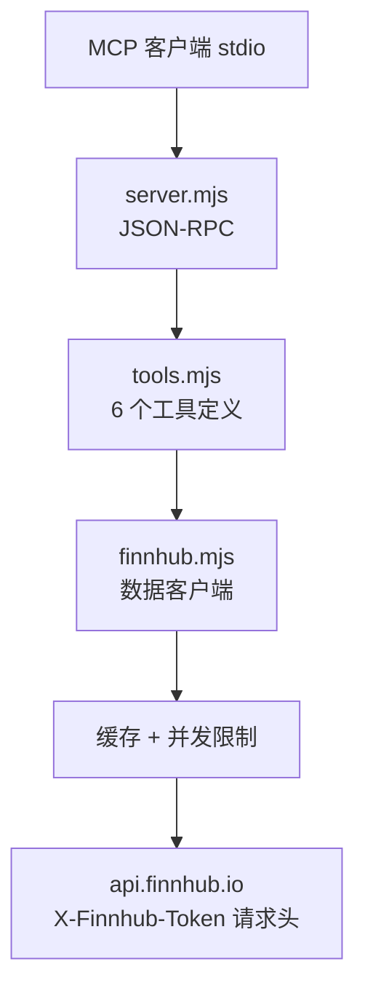

<div align="center">

# 📈 OpenStock Finnhub MCP

**一个轻量级 stdio MCP 服务器，让 AI Agent 通过 Finnhub API 只读访问股票报价、公司资料、市场新闻和加密货币币对。**

受 [OpenStock](https://github.com/Open-Dev-Society/OpenStock) 启发，零 npm 依赖，运行于 Node 18+。

[](LICENSE)
[](https://nodejs.org/)
[](https://modelcontextprotocol.io/)
[](package.json)
[](#环境要求)

[English](README.md) · [简体中文](README_zh-CN.md)

</div>

---

## 为什么需要这个项目？

AI Agent 经常被问"AAPL 现在多少钱？""NVIDIA 最近有什么新闻？"。直接调用行情 API 需要自己处理代码格式、鉴权、频率限制和异常响应。本服务器把 Finnhub 封装成 6 个类型化、只读的 MCP 工具：

- **零依赖**：使用 Node 内置 `fetch`，运行时无需 `npm install`。
- **密钥只从环境变量读取**：绝不通过工具参数接收密钥。
- **股票和加密货币**：股票代码（`AAPL`、`7203.T`）和加密币对（`BINANCE:BTCUSDT`）。
- **健壮**：响应缓存、并发限制、HTTP 429/401/403 都有清晰提示；批量报价保留部分成功结果。

> **只读。** 本服务器只获取行情数据，绝不下单或修改任何账户。

---

## 环境要求

| 要求 | 说明 |
|---|---|
| Node.js | 18+（内置 `fetch`） |
| Finnhub API 密钥 | 在 [finnhub.io/register](https://finnhub.io/register) 免费注册 |
| 网络 | 能访问 `https://finnhub.io` |

## 获取 Finnhub API 密钥

1. 在 [finnhub.io/register](https://finnhub.io/register) 注册并登录。
2. 打开 [Dashboard](https://finnhub.io/dashboard)。
3. 复制页面上的 API Key。

启动服务器前在环境中设置：

```powershell
# Windows（PowerShell）
$env:FINNHUB_API_KEY = "your-key"
```

```bash
# macOS / Linux
export FINNHUB_API_KEY="your-key"
```

> 可通过 `FINNHUB_API_KEYS` 传入多个逗号分隔的密钥，在触发频率限制时轮换。

---

## MCP 客户端配置

```json
{
  "mcpServers": {
    "openstock": {
      "command": "node",
      "args": ["C:\\absolute\\path\\to\\openstock\\server.mjs"],
      "env": {
        "FINNHUB_API_KEY": "your-key"
      }
    }
  }
}
```

macOS / Linux 使用对应的绝对路径。如果 `node` 不在 `PATH`，请填写 Node 可执行文件的完整路径。

---

## 工具列表（6 个）

| 工具 | 用途 |
|---|---|
| `search_stocks` | 按关键词搜索代码 / 公司 / 市场（Finnhub `/search`） |
| `get_stock_quote` | 现价、涨跌额、涨跌幅、开高低收、前收盘、时间戳 |
| `get_company_profile` | 公司名、交易所、行业、币种、市值、官网、Logo |
| `get_market_news` | 最新市场新闻；分类 `general` / `forex` / `crypto` / `merger` |
| `get_company_news` | 最近 N 天的公司新闻，含来源、标题、摘要、时间、URL |
| `get_multiple_quotes` | 最多 10 个代码的批量报价；保留部分失败结果 |

### 代码示例

| 类型 | 示例 |
|---|---|
| 美股 | `AAPL`、`TSLA`、`NVDA` |
| 日股 | `7203.T` |
| 加密币对 | `BINANCE:BTCUSDT`、`BINANCE:ETHUSDT` |

> 报价是实时还是延迟，取决于你的 Finnhub 套餐和市场覆盖范围，报价结果中会附带相应说明。

---

## 工作原理



- **stdio 传输**：纯换行分隔的 JSON-RPC 走 stdin/stdout。
- **密钥处理**：密钥通过 `X-Finnhub-Token` 请求头发送，绝不拼进 URL 或作为工具参数。
- **缓存**：短 TTL 减少重复调用；返回前会校验响应。

---

## 常见问题

| 问题 | 检查 / 解决 |
|---|---|
| `Missing FINNHUB_API_KEY` | 在环境或客户端的 `env` 块中设置该变量 |
| HTTP 401 / 403 | 检查密钥、Finnhub 套餐和代码覆盖范围 |
| HTTP 429 | 触发频率限制，等待重试，或通过 `FINNHUB_API_KEYS` 提供多个密钥 |
| 报价全为 0 / `available: false` | 该代码可能不受支持，在 Finnhub 上核实 |
| `fetch is not a function` | 升级到 Node 18+ |
| 公司资料工具拒绝加密币对 | 公司资料需要股票代码，不支持加密币对 |

---

## 项目结构

```
openstock/
├── server.mjs      # stdio MCP JSON-RPC 服务器
├── finnhub.mjs     # Finnhub 数据客户端（缓存、限制、校验）
├── tools.mjs       # 6 个工具 schema 与分发
├── package.json
└── README.md
```

## 致谢

本服务器是受开源项目 [OpenStock](https://github.com/Open-Dev-Society/OpenStock) 的 Finnhub 行情功能启发而做的非官方轻量改编，与 Finnhub 无关联、未获其背书。

## 许可证

[MIT](LICENSE)
